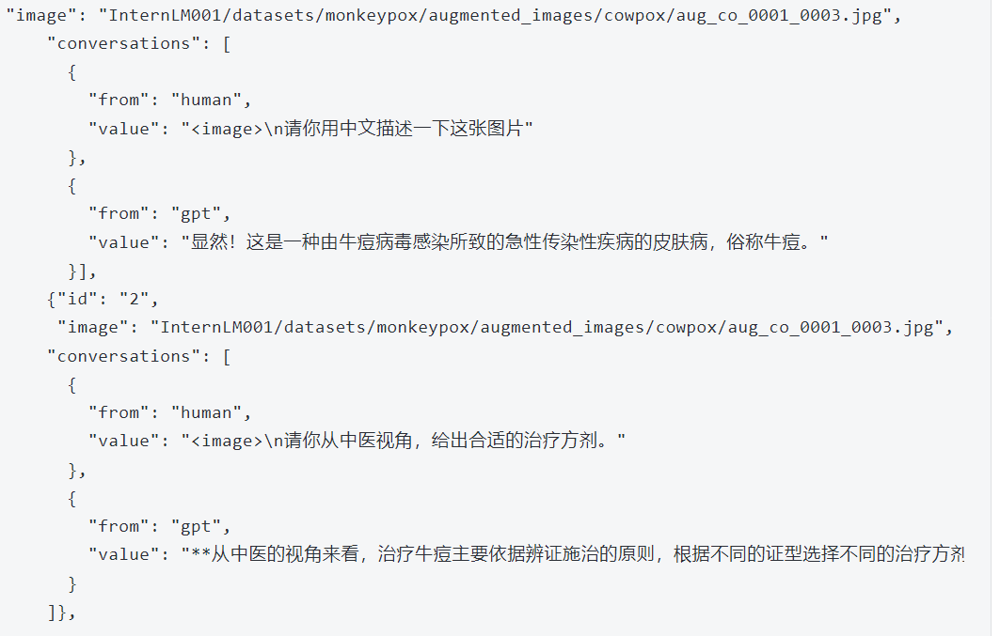
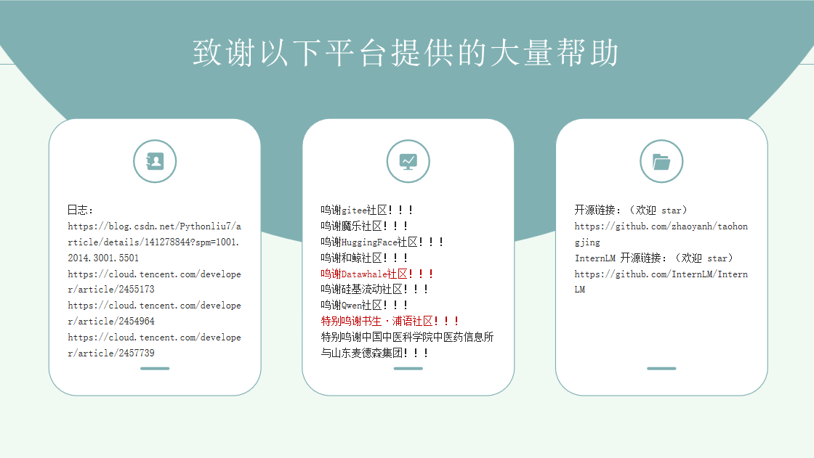

# Hongjing Traditional Chinese Medicine Large Model
# Project Background
### Introduction to the Figure
Tao Hongjing is one of the earliest and most significant contributors to the development of Chinese materia medica in history. During his era, there were more than ten materia medica works, but no unified standards. Particularly, ancient texts had become obsolete, their contents were disorganized, herbs and minerals were indistinguishable, and insects and beasts were not properly differentiated, making clinical application quite inconvenient. Tao Hongjing took on the heavy responsibility of "comprehensively organizing all classics, researching and streamlining complex materials." He integrated the *Shennong Bencao Jing* (Classic of the Divine Farmer's Materia Medica) and medical annotations (*Mingyi Bielu*), along with his own insights, to author *Bencao Jing Jizhu* (Collected Commentaries on the *Classic of Materia Medica*). It included 730 medicinal substances and pioneered a drug classification method that remains in use today, categorizing them by minerals/rocks, plants, insects, animals, fruits, vegetables, and grains (the original manuscript is lost, but fragments were discovered in Dunhuang). This work stands as a milestone in the history of Chinese materia medica.
The Hongjing TCM Large Model includes Named Entity Recognition (NER), Relation Extraction, Knowledge Graph Construction, Large Model Incremental Fine-tuning, and RAG.
### Prospects
The TCM Large Model can leverage deep learning and natural language processing techniques to mine and integrate classic TCM theories, including formula composition, compatibility, and clinical application information. This accelerates the early discovery and development process of new TCM drugs.
Through application modes such as intelligent Q&A and interactive computing, the TCM Large Model provides doctors with auxiliary diagnostic and treatment advice ranging from syndrome differentiation to formulas, and from formulas to herbs, assisting in the formulation of personalized treatment plans.<br>

In summary, the TCM Large Model holds immense commercial potential in the healthcare sector. It not only drives the digital transformation of the TCM industry but also promotes the intelligent development of health management, while providing support for the international dissemination and market expansion of TCM culture.

### Competition
This competition is primarily hosted by Datawhale x iFlytek x InternLM (书生·浦语).<br>

The overall requirement is to perform large model fine-tuning on the iFlytek Xingchen MaaS platform and submit a competition proposal, aiming to build an intelligent TCM Q&A system. By integrating TCM knowledge, it will provide an efficient, accurate, and user-friendly Q&A platform.
# Project Workflow

# Project Progress
### 🎉 InternLM (书生·浦语)
  XTuner: Instruction Fine-tuning, Incremental Pre-training
  InternLM Community: InternStudio Development Machine 
  🔥 Better models are always on the way! 🔥
  
   * Dec. 15,2024: Uploaded code related to fine-tuning and model development.
   * Oct. 16,2024: Uploaded Data Processing
 
📚 Data Details
### pretrain_data
See master/dataset 
### Multimodal Data
* Data preparation
* After searching for skin disease images, we obtained a monkeypox skin image dataset from the Heywhale community. The dataset contains skin lesion/rash images across five different disease categories: (1) Monkeypox, (2) Chickenpox, (3) Smallpox, (4) Cowpox, (5) Measles, as well as (6) Healthy skin images. (The original dataset author also increased the data volume by 49 times using various augmentation techniques.) We also conducted fine-tuning experiments on the InternLM InternVL2-2B multimodal large model.
JSON file format (We constructed the following conversation pairs for model training.) <br>


# 📅 Model List

| Model Name           | Model Type      | Base-Model            | XTuner Fine-tuning        |
|--------------------|-----------------|----------------------|-------------------------|
| 🆕HongjingBot-VL     | Image-Text Understanding | InternVL2-2B           | qlora_finetune           |
| 🆕HongjingBot-chat   | Conversational     | InternLM2.5-7B-chat    | qlora_alpaca_e3 full_custom_pretrain_e1 |    

🌈 Model Introduction <br>
🎓 Model Evaluation (Not yet conducted) (No suitable benchmark found) <br>
👋 Contact Us: 644735344@qq.com <br>
# Quick Deployment and Quantization
### 🔓 Usage
🆕HongjingBot-chat  

```python
lmdeploy serve api_server \
    /root/InternLM/XTuner/merged01 \
    --model-format hf \
    --quant-policy 0 \
    --server-name 0.0.0.0 \
    --server-port 23333 \
    --tp 1
```
Gradio: Built-in frontend for lmdeploy deployment
```python
lmdeploy serve gradio http://localhost:23333 \
    --server-name 0.0.0.0 \
    --server-port 6006
```
SuWen: RAG system implementation based on MindSearch
```
python -m mindsearch.app --lang cn --model_format internlm_server --search_engine DuckDuckGoSearch
```
```
streamlit run frontend/suwen_streamlit.py
```
##### Quantization Deployment
* Online kv cache int4/int8 quantization
```
lmdeploy serve api_server \
    /root/models/merged01 \
    --model-format hf \
    --quant-policy 4 \
    --cache-max-entry-count 0.4\
    --server-name 0.0.0.0 \
    --server-port 23333 \
    --tp 1
```
* W4A16 model quantization and deployment
```
lmdeploy serve api_server \
    /root/models/merged01 \
    --model-format hf \
    --quant-policy 4 \
    --cache-max-entry-count 0.4\
    --server-name 0.0.0.0 \
    --server-port 23333 \
    --tp 1
```
* W4A16 quantization + KV cache + KV cache quantization
```
lmdeploy serve api_server \
    /root/models/merged01-w4a16-4bit/ \
    --model-format awq \
    --quant-policy 4 \
    --cache-max-entry-count 0.4\
    --server-name 0.0.0.0 \
    --server-port 23333 \
    --tp 1
```

🆕HongjingBot-VL
Run test1
```python
conda activate lmdeploy
python test1.py
```

## 📝 License

This project is released under the [Apache 2.0 license](LICENSE).

# Project Honors
# Project Stars
# Project Members
🚩 Recruitment ongoing
# Acknowledgements

🤗✡️🤖
